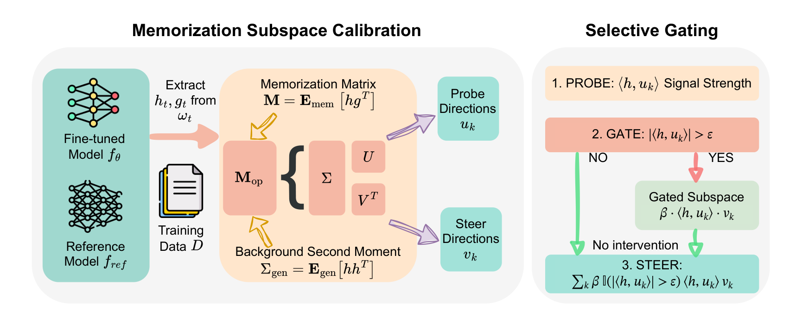
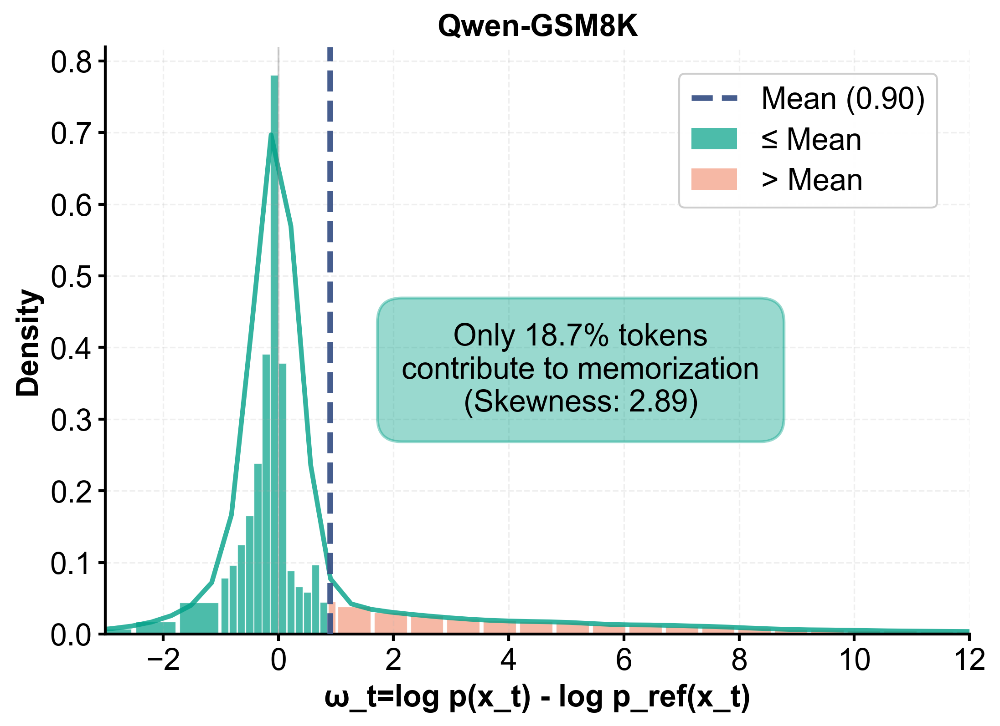
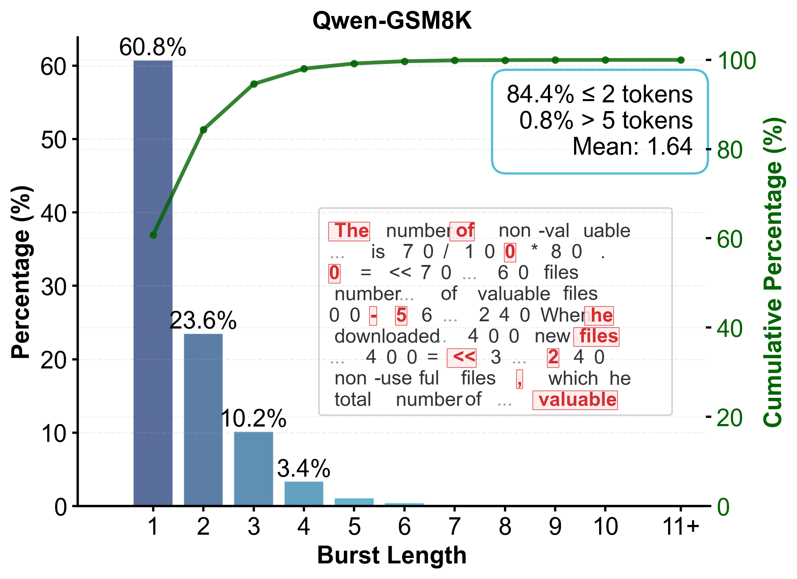
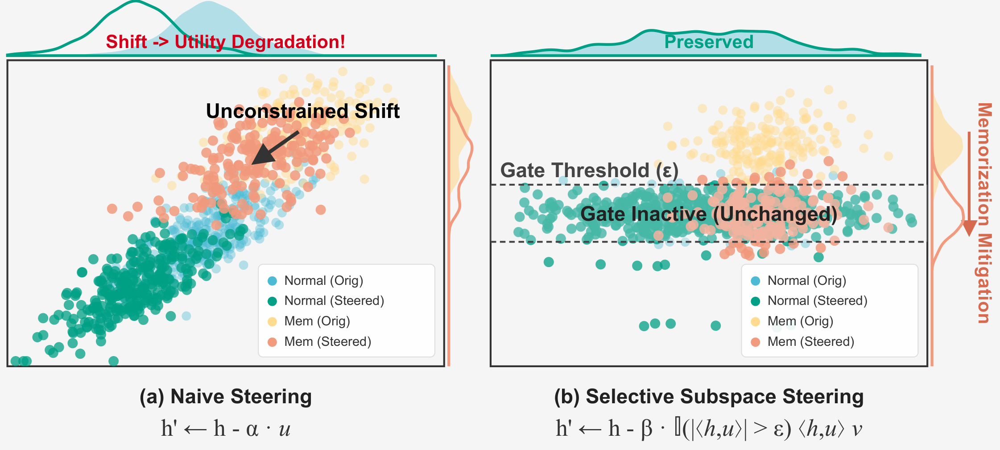

# Mitigating Memorization Where It Happens

<p align="center">
  <b>🔥 [NeurIPS'26] Gated Subspace Steering (GSS): official code</b>
</p>

<p align="center">
  <a href="https://arxiv.org/abs/2602.08901"></a>
  <a href="https://arxiv.org/pdf/2602.08901"></a>
  <a href="https://openreview.net/forum?id=hV2JIz6mgg"></a>
  
  
  
</p>

<p align="center">
  <a href="https://arxiv.org/pdf/2602.08901"><b>📄 Paper (PDF)</b></a> |
  <a href="#key-insight">Key Insight</a> |
  <a href="#using-gss-on-your-own-model">Use on your model</a> |
  <a href="#repository-structure">Repository</a>
</p>

*Xuanqi Zhang, Haoyang Shang, Xiaoxiao Li*
The University of British Columbia, Vector Institute.

GSS is an inference-time intervention that reduces verbatim memorization without updating
model weights. A token-level likelihood ratio between the target model and a low-exposure
reference model shows where memorization happens. From this signal GSS computes, in closed
form, a **probe** direction that detects memorization-relevant activations and a **steer**
direction that corrects them. At generation time, a calibrated **gate** applies the
correction only at positions where the probe fires. The reference model is used only during
calibration.

<p align="center">
  
  <br>
  <sub>Fig. 1: (left) offline calibration estimates probe and steer directions from activation–gradient statistics, whitened by a background second moment; (right) online, the gate applies the correction only when |⟨h, u<sub>k</sub>⟩| > ε.</sub>
</p>

This release contains the implementation of GSS for the TinyMem experiments (paper Table 1).

---

## Contents

- [Key insight](#key-insight)
- [Requirements](#requirements)
- [Using GSS on your own model](#using-gss-on-your-own-model)
- [Method summary](#method-summary)
- [Repository structure](#repository-structure)
- [Acknowledgements](#acknowledgements)
- [Citation](#citation)
- [License](#license)

---

## Key insight

Memorization is usually measured per sequence, but the excess predictive advantage that
drives verbatim recall is not spread evenly across a sequence. Across the evaluated settings,
a minority of positions carries a disproportionate share of the positive target–reference
signal ω_t, and exposure-controlled experiments associate it with sequence-level verbatim
recall. Uniform interventions therefore spend most of their utility budget on positions that
do not need correction; GSS spends it only where the signal concentrates.

<p align="center">
  
  
  <br>
  <sub>Fig. 2: (a) distribution of the token-level signal; (b) lengths of consecutive positive-signal runs.</sub>
</p>

A high-signal position is a *candidate* for correction, not a certified memorized token. GSS
is evaluated by sequence-level reproduction and by independent utility metrics.

## Requirements

Tested with Python 3.10, PyTorch 2.3.0 (CUDA 12.1), and Transformers 4.41.0 on NVIDIA L40S GPUs.

```bash
git clone https://github.com/ubc-tea/Mitigating-Memorization-Where-It-Happens.git
cd Mitigating-Memorization-Where-It-Happens
conda create -n gss python=3.10 -y
conda activate gss
pip install -r requirements.txt
pip install -e .
```

A single GPU is enough; the math settings also run on a CPU.

## Using GSS on your own model

```python
from src import gss_tinymem as gss

cfg = gss.GSSConfig(point="transformer.h.2.mlp", kind="whitened", tau=0.0, rank=1,
                    q=0.9995, beta=0.3, sign=-1.0, r=2)
# calib_rows: [N, T] token ids of memorized sequences; clean_rows: [M, T] clean token ids
artifact = gss.fit(target_model, reference_model, calib_rows, clean_rows, cfg)
hook = gss.attach(target_model, artifact)    # steering is now active for every forward pass
...                                           # generate / evaluate as usual
hook.remove()                                 # detach
```

`point` is the name of any module in `model.named_modules()` whose output is a hidden state
`[batch, time, d]`.

## Method summary

For calibration sequences x, GSS computes the token-level signal

  ω_t = log p_θ(x_t | x_<t) − log p_ref(x_t | x_<t),

and marks high-signal positions (ω_t > τ) and low-signal positions (ω_t ≤ 0). With h_t the
activation at the hooked module and g_t the gradient of the masked cross-entropy:

- **whitened**: M_hi = Σ_hi h_t g_tᵀ and C = Σ_lo + γI = LLᵀ, where Σ_lo is the uncentered
  second moment of the low-signal activations. The SVD L⁻¹M_hi = ŨSṼᵀ gives the probes
  U = L⁻ᵀŨ_{:,1:K} and the steers V = Ṽ_{:,1:K}. This is the closed-form optimum of
  max tr(UᵀM_hiV) s.t. UᵀCU = I, VᵀV = I (Theorem 4.1).
- **gate**: ε is the q-quantile of |u_kᵀh| on clean text. At inference,

  h′_t = h_t − sign · β · Σ_k 1(|u_kᵀh_t| > ε) (u_kᵀh_t) v_k,

  optionally applied only after r consecutive positions exceed ε.

<p align="center">
  
  <br>
  <sub>Fig. 3: (a) a fixed steering update moves every activation; (b) GSS corrects only above the threshold. Regions are schematic.</sub>
</p>

The steering sign is a hyper-parameter. To first order, the subtractive update
(sign = +1) lowers the cross-entropy at high-signal positions (paper Appendix A.3), so both
signs are searched.

## Repository structure

```
src/gss_tinymem.py                  GSS: statistics, directions, gate calibration, steering hook
scripts/gss_tinymem/common.py       TinyMem settings, data splits, metrics
scripts/gss_tinymem/run_gss_tinymem.py   fit + evaluate one setting
scripts/gss_tinymem/search.py       hyper-parameter search (stages A/B/C, resumable)
scripts/gss_tinymem/collect_best.py selection rule -> configs/gss_tinymem_best.json
scripts/gss_tinymem/verify_fast_metric.py   fast metric == generation metric check
configs/gss_tinymem_best.json       released configurations
results/gss_tinymem_search/         search logs (jsonl) and SUMMARY.md
src/localize/, src/memorization_in_toy_models.py, ...   TinyMem training and baselines (Sakarvadia et al.)
```

## Acknowledgements

This repository builds on the TinyMem benchmark and the memorization-mitigation baselines of
[Sakarvadia et al., *Mitigating Memorization in Language Models* (ICLR 2025)](https://github.com/msakarvadia/memorization);
their original README is kept in [docs/TinyMem_original_README.md](docs/TinyMem_original_README.md).

## Citation

```bibtex
@inproceedings{zhang2026gss,
  title     = {Mitigating Memorization Where It Happens},
  author    = {Zhang, Xuanqi and Shang, Haoyang and Li, Xiaoxiao},
  booktitle = {Advances in Neural Information Processing Systems},
  year      = {2026},
  url       = {https://openreview.net/forum?id=hV2JIz6mgg},
  eprint    = {2602.08901},
  archivePrefix = {arXiv}
}
```

## License

MIT; see [LICENSE](LICENSE). The TinyMem code and baselines are © 2024 Mansi Sakarvadia
under the same license.
